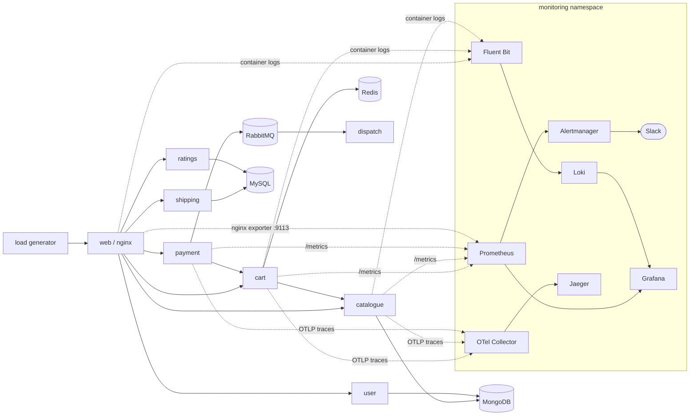

# Capstone 2: Stan's Robot Shop, Observed and Operated

> Project-created document (not instructor-provided). Fork of `instana/robot-shop`, deployed to the Capstone 1 Kind cluster (`kind-voting-app-cluster`). Everything below was built, run and verified on 2026-10-28; the evidence files hold the raw output.

## What was delivered (brief: six steps)

| Step | Delivered | Where |
|---|---|---|
| 1. Deploy and watch | Robot Shop installed with the provided Helm chart (Instana settings removed), load generator running, all pods healthy | `K8s/helm/`, `K8s/load-deployment.yaml` |
| 2. See the metrics | kube-prometheus-stack via Helm; Golden Signals dashboard (requests, errors, latency) exported as code | `observability/prometheus/`, `observability/grafana/` |
| 3. Collect the logs | Fluent Bit → Loki, searchable by `service` and `level` | `observability/logging/` |
| 4. Follow one trace | OpenTelemetry Collector → Jaeger; multi-service traces payment → cart and cart → catalogue | `observability/tracing/`, `K8s/helm/templates/metrics-instrumentation-configmap.yaml` |
| 5. Set one SLO | 99% availability SLO, one-page error-budget policy, burn alert to Slack with runbook link | `observability/slo/`, `observability/alerting/`, `observability/runbooks/` |
| 6. Incident drill | Two controlled MongoDB-outage drills; alert fired both times; Slack delivery verified in run 2; blameless postmortem | `observability/incident-drill/` |

## Architecture



- **Metrics:** cart, catalogue and payment expose `http_requests_total` and `http_request_duration_seconds` through code mounted from a project ConfigMap; web exposes nginx stub-status through a sidecar exporter. Two ServiceMonitors scrape them every 15s.
- **Traces:** the same ConfigMap code sends OTLP/HTTP spans and propagates W3C `traceparent` headers.
- **Logs:** a Fluent Bit DaemonSet tails container logs and labels them `namespace`, `service`, `pod`, `container` and `level`.

## Deploy (from a fresh clone, onto an existing Kind cluster)

```bash
# 1. Robot Shop + load generator
helm upgrade --install robot-shop K8s/helm -n robot-shop --create-namespace
kubectl -n robot-shop apply -f K8s/load-deployment.yaml

# 2. Metrics (chart pinned to the version used)
helm repo add prometheus-community https://prometheus-community.github.io/helm-charts
helm upgrade --install kube-prometheus-stack prometheus-community/kube-prometheus-stack \
  --version 92.14.0 -n monitoring --create-namespace -f observability/prometheus/kube-prometheus-stack-values.yaml
kubectl apply -f observability/prometheus/robot-shop-servicemonitor.yaml
kubectl apply -f observability/grafana/robot-shop-golden-signals-configmap.yaml

# 3. Logs and 4. traces
kubectl apply -f observability/logging/
kubectl apply -f observability/tracing/

# 5. SLO rules, then Slack (create the webhook Secret by hand first; never commit it)
kubectl apply -f observability/alerting/robot-shop-slo-rules.yaml
kubectl -n robot-shop create secret generic alertmanager-slack-webhook --from-file=url=/dev/stdin   # paste URL, Ctrl+D
kubectl apply -f observability/alerting/alertmanager-slack-config.yaml
```

Do not use `helm --wait` for `robot-shop` on Kind: the `web` LoadBalancer never gets an external IP, so Helm times out (this happened once; it is recorded as release revision 11 = failed, and revision 12 = deployed).

## Validate

```bash
bash observability/final-validation.sh          # read-only; writes observability/incident-drill/evidence/final-validation.txt
bash observability/port-forward-uis.sh          # Grafana :3000, Prometheus :9090, Alertmanager :9093, Jaeger :16686, shop :8080
```

The final validation (2026-10-28 21:52 UTC) found:
- **Helm:** robot-shop revision 12 `deployed`; kube-prometheus-stack `deployed`.
- **Pods:** none outside Running.
- **Prometheus targets:** cart, catalogue, payment and web all UP.
- **SLI:** error ratio 0, alert inactive, both SLO rule groups healthy.
- **Alertmanager:** Slack notifications counter = 2.
- **Jaeger:** fresh payment→cart and cart→catalogue traces.
- **Capstone 1:** `default` namespace untouched (`my-vote-release` revision 4).

## SLO and incident (summary)

- **SLO:** 99% of cart and catalogue requests succeed over a rolling 24h. **Alert:** 5-minute error ratio > 5% for 2 minutes (a 5× burn rate). These are deliberately two different numbers. A *resolved* alert is not proof of SLO recovery; the runbook defines recovery as 1-minute errors at 0, 5-minute ratio < 1%, and traffic back to normal.
- **Drill:** MongoDB scaled to 0. Catalogue returned 500s, and the alert fired after 6m24s (run 1) and 5m37s (run 2). **Root cause of the long outage:** catalogue never reconnects to MongoDB and has no health probes, so it needed a restart even after MongoDB was back.
- Full details: [POSTMORTEM.md](observability/incident-drill/POSTMORTEM.md), [SLO](observability/slo/robot-shop-availability-slo.md), [error-budget policy](observability/slo/error-budget-policy.md), [runbook](observability/runbooks/robot-shop-availability-slo.md).

## Evidence index

| Evidence | File |
|---|---|
| Requirement-by-requirement checklist | [observability/SUBMISSION-EVIDENCE.md](observability/SUBMISSION-EVIDENCE.md) |
| Final deployment validation | [evidence/final-validation.txt](observability/incident-drill/evidence/final-validation.txt) |
| Drill run 1 (alert fires; no Slack yet) | [evidence/01–04](observability/incident-drill/evidence/) |
| Drill run 2 (Slack delivery verified) | [evidence/run2-slack/](observability/incident-drill/evidence/run2-slack/) |
| Screenshots | [observability/screenshots/](observability/screenshots/) |

## Known limitations

- **`web` LoadBalancer is `<pending>`.** Kind has no cloud load balancer; access is by port-forward or NodePort. This is not a healthy external endpoint.
- **payment is outside the SLO.** The load generator's `ERROR="1"` sends deliberate failing payments under the same route label as real ones.
- **Server-side SLI.** A failure that stops users from reaching cart and catalogue lowers traffic instead of raising errors; this slowed detection in the drill (postmortem action items 2 and 3).
- **Catalogue does not recover from a MongoDB restart by itself** (postmortem action item 1, not yet fixed).
- **Instana leftovers in upstream images.** The project code has no Instana; the `rs-web` image still loads an Instana nginx tracer, and the `user` image still runs `@instana/collector` (it logs "Agent cannot be contacted"). No Instana agent is configured.
- **Lab constraints.** Prometheus keeps 24h of data (hence the 24h SLO window). Host sleep (Modern Standby 20:46–21:21 UTC on 2026-10-28) caused a monitoring gap from about 20:57 to 21:21; this was not a service fault.
- **Grafana resources.** Grafana was resized to 1 CPU / 512Mi on 2026-10-28 after the original 200m/256Mi limit caused timeouts and 18 restarts (kube-prometheus-stack revision 4).
